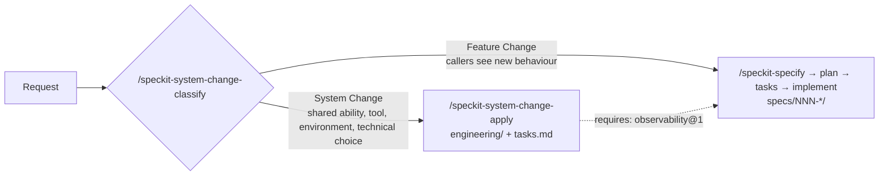

# Spec Kit System Change — sample

A small sample that answers one question:

> With spec-driven development, how do you handle work that isn't a feature spec?
> Tooling (Figma Code Connect, MCP), dev environments, CI, observability…

The answer: **don't squeeze it into a feature spec, and don't leave it in the gaps
between specs.** Give it its own route and its own files.

This repository adds that route to [GitHub Spec Kit](https://github.com/github/spec-kit)
as an **extension** and a **workflow**, without forking Spec Kit.

The worked example is a fictional **Bookmarks API** — a small Node.js service, with
no runtime dependencies, that saves and lists links. There is no application code
here, only the spec and `engineering/` files. The System Change is *make requests
observable*; the Feature Change that depends on it is *export bookmarks as CSV*.

## Two routes



| | Feature Change | System Change |
|---|---|---|
| Changes | What a user or API caller can observe | What the system can do, what it connects to, where it runs |
| Examples | "Export bookmarks as CSV" | "Add observability", "Set up Figma Code Connect", "Run CI on Node 24" |
| Path | Spec Kit core: `/speckit-specify` → `/speckit-plan` → `/speckit-tasks` → `/speckit-implement` | This extension: `/speckit-system-change-classify` → human gate → `/speckit-system-change-apply` → review |
| Writes | `specs/NNN-*/spec.md`, `plan.md`, `tasks.md` | `engineering/…` files and `.specify/system-changes/<slug>/tasks.md` |
| Describes | A **change** | The **current state** |

If a request is both, split it. The System Change goes first; the feature spec then
says `requires: observability@1` instead of re-explaining it.

## What's in the repository

```text
extensions/system-change/          ← the extension (source)
  extension.yml                      manifest: 2 commands, 4 templates
  commands/speckit.system-change.classify.md
  commands/speckit.system-change.apply.md
  templates/                         adr / capability / contract / environment
workflows/system-change/workflow.yml ← the workflow (source)

engineering/                       ← current state (convention, not Spec Kit)
  README.md                          what changed → where to update
  decisions/0001-no-runtime-dependencies.md             Decision (ADR, accepted earlier)
  decisions/0002-log-requests-as-json-lines.md          Decision (ADR, proposed)
  capabilities/observability/capability.yaml            Capability
  integrations/log-collector/contract.yaml              Integration contract
  environments/production/environment.yaml              Environment
  standards/logging.md                                  Standard
specs/001-bookmark-export/spec.md          ← a feature that requires observability@1
.specify/system-changes/add-observability/ ← the worked example's classification and tasks

.specify/ (other files), .github/skills/  ← generated by `specify init` and the installs
```

The worked-example files were written by hand to show the expected result. They
were not generated by running the commands.

| File | Answers | Lifetime |
|---|---|---|
| ADR | **Why** did we choose this? | Permanent — supersede, never rewrite |
| `capability.yaml` | **What** can the system do? | Long — edit to stay true |
| `contract.yaml` | What does it connect to, on what terms? | Long — breaking change = new version |
| `environment.yaml` | **Where** does it run, and what must be true there? | Medium |
| `spec.md` | What **change** do callers need? | One feature |

The "what changed → where to update" table is in
[engineering/README.md](engineering/README.md).

## Try it

The extension and workflow are already installed in this repository. You need
[Spec Kit](https://github.com/github/spec-kit) v1.0.12 (`specify`) and GitHub
Copilot CLI. The repository was initialized with `--script ps`: the two System
Change commands use no scripts, but the core Spec Kit commands here call PowerShell
scripts (on macOS or Linux, install PowerShell 7, or set it up in your own
repository with `--script sh` as shown below).

**1. Check the skills are there** — from a terminal in the repository root:

```powershell
copilot skill list
```

Under **Project skills** you should see:

```text
speckit-system-change-apply - Create or update the engineering/ files listed in a System Change classification, and write its enabling tasks
speckit-system-change-classify - Classify a request as a Feature Change or a System Change, and list the engineering/ files to create or update
```

**2. Use the commands** — in a Copilot CLI session:

```text
/speckit-system-change-classify Run the test suite in CI on Node 22 and Node 24 for every pull request slug=ci-node-matrix
```

It writes only `.specify/system-changes/ci-node-matrix/classification.md`: the
route, the kind of each piece, and which ADR / capability / contract / environment
files to create or update. Read it, fix it if it's wrong, then:

```text
/speckit-system-change-apply slug=ci-node-matrix
```

It drafts those files from the templates (ADRs as `proposed`, new capabilities and
contracts as `planned`) and writes `.specify/system-changes/ci-node-matrix/tasks.md`.
It never edits an accepted ADR.

If classify says **Feature Change**, it tells you to start with `/speckit-specify`
instead.

**3. Or run it as a workflow** — from a terminal:

```powershell
specify workflow info system-change
specify workflow run system-change -i request="Run the tests in CI on Node 22 and 24" -i slug=ci-node-matrix
```

The workflow runs classify, stops at a **gate** where you choose `system-change`,
`feature-change` or `reject`, then either runs apply and a second review gate, or
prints the Feature Change handoff.

> **Read this before you run the workflow.** With Copilot, every command step runs
> as `copilot -p "/speckit-…" --yolo`, which allows all tools. Set
> `SPECKIT_COPILOT_ALLOW_ALL_TOOLS=0` to turn that off. At a gate, closing the
> prompt without an answer picks the last option (`reject`) and stops the run. If
> there is no terminal to ask in, the gate pauses; continue with
> `specify workflow resume <run_id>`.

## Set it up from scratch

To add the same thing to another repository (PowerShell shown; use `--script sh`
on macOS or Linux):

```powershell
specify init --here --integration copilot --script ps
specify extension add --dev <path-to>\extensions\system-change
specify workflow add --dev <path-to>\workflows\system-change
copilot skill list
```

After you edit the extension, reinstall it with
`specify extension add --dev <path> --force`. The installed copy lives in
`.specify/extensions/system-change/`; the Copilot skills in
`.github/skills/speckit-system-change-*/`.

### The extension, in short

- **Manifest** — `extension.yml`, `schema_version: "1.0"`. Command names must be
  `speckit.<extension-id>.<command>`.
- **Command names in Copilot** — in skills mode (the default) Spec Kit writes each
  command to `.github/skills/speckit-<name>/SKILL.md`, so
  `speckit.system-change.classify` becomes `/speckit-system-change-classify`.
- **Cross-references** — a command body writes `__SPECKIT_COMMAND_SPECIFY__` and
  Spec Kit replaces it with the right spelling for the agent (`/speckit-specify`
  for Copilot).
- **Extensions can't carry workflows.** An extension provides commands, templates and
  scripts. A workflow is installed with `specify workflow add`, or both are packaged
  together as a **bundle** — Spec Kit's own `bugfix` bundle is the `bug` extension
  plus the `bugfix` workflow.

## What is Spec Kit, and what is convention

| Spec Kit (v1.0.12) | Convention in this sample |
|---|---|
| Extensions, workflows, bundles, gates, `switch` | The `engineering/` folder and its five sub-folders |
| `specs/NNN-*/` and the core commands | The Feature Change / System Change split |
| `.specify/memory/constitution.md` | `requires: <id>@<version>` in specs |
| `/speckit-analyze` for cross-artifact checks | The kinds: Decision, Capability, Integration contract, Environment, Standard, Enabling task |

Spec Kit does not read or validate `engineering/` or `requires:`. The agent uses
them because they are in the repository and the commands tell it to.

## Checked against Spec Kit v1.0.12

Checked on 2026-09-28 against tag
[`v1.0.12`](https://github.com/github/spec-kit/tree/v1.0.12) (commit `e77daa9`) and
on this machine.

| Claim | Source | Status |
|---|---|---|
| New command or process → extension; multi-step automation → workflow; both → bundle | [docs/guides/customization.md](https://github.com/github/spec-kit/blob/v1.0.12/docs/guides/customization.md) | Confirmed |
| `bugfix` bundle = `bug` extension + `bugfix` workflow | [docs/reference/bundles.md](https://github.com/github/spec-kit/blob/v1.0.12/docs/reference/bundles.md), [bundles/bugfix](https://github.com/github/spec-kit/tree/v1.0.12/bundles/bugfix) | Confirmed |
| Manifest is `extension.yml` with `schema_version`, `extension`, `requires.speckit_version`, `provides.commands/templates/scripts`, `hooks` | [extensions/EXTENSION-DEVELOPMENT-GUIDE.md](https://github.com/github/spec-kit/blob/v1.0.12/extensions/EXTENSION-DEVELOPMENT-GUIDE.md) | Confirmed; this manifest installed |
| Command names must match `speckit.<ext>.<cmd>` | EXTENSION-DEVELOPMENT-GUIDE.md, `src/specify_cli/extensions/` | Confirmed |
| Local install: `specify extension add --dev <path>`, into an initialized project | [docs/reference/extensions.md](https://github.com/github/spec-kit/blob/v1.0.12/docs/reference/extensions.md) | Confirmed; run here |
| An extension cannot ship a workflow; use `specify workflow add` or a bundle | EXTENSION-DEVELOPMENT-GUIDE.md, [docs/reference/bundles.md](https://github.com/github/spec-kit/blob/v1.0.12/docs/reference/bundles.md) | Confirmed |
| Workflow step types: command, prompt, shell, init, slot, gate, if, switch, while, do-while, fan-out, fan-in | [docs/reference/workflows.md](https://github.com/github/spec-kit/blob/v1.0.12/docs/reference/workflows.md) | Confirmed |
| A gate's choice is `steps.<id>.output.choice`; a `switch` can branch on it | docs/reference/workflows.md | Confirmed; smoke-tested (below) |
| Gate: `reject` with `on_reject: abort` stops the run; EOF picks the last option; no TTY → pause, then `specify workflow resume` | docs/reference/workflows.md, `src/specify_cli/workflows/step/gate/__init__.py` | Confirmed (source + smoke test) |
| `specify workflow add --dev <dir>` validates and installs a local workflow | `src/specify_cli/workflows/command_add.py` | Confirmed; run here |
| `specify workflow validate` command | Mentioned once in docs/reference/workflows.md (`verdict_input`) | **Unconfirmed** — not in `specify workflow --help` for 1.0.12; validation runs during `workflow add` |
| Copilot skills mode is the default; commands appear as `/speckit-specify`, extension commands as `/speckit-bug-assess` | [docs/reference/integrations.md](https://github.com/github/spec-kit/blob/v1.0.12/docs/reference/integrations.md) | Confirmed; `copilot skill list` shows `speckit-system-change-*` |
| `__SPECKIT_COMMAND_<NAME>__` tokens become the agent's command spelling | EXTENSION-DEVELOPMENT-GUIDE.md | Confirmed; rendered as `/speckit-system-change-apply` in `SKILL.md` |
| Workflow command steps run `copilot -p … --yolo` unless `SPECKIT_COPILOT_ALLOW_ALL_TOOLS=0` | `src/specify_cli/integrations/copilot/__init__.py` | Confirmed (source); not run end to end here |
| Discoveries flow back into the closest artifact, then `/speckit-analyze` | [docs/guides/evolving-specs.md](https://github.com/github/spec-kit/blob/v1.0.12/docs/guides/evolving-specs.md) | Confirmed |
| Spec Kit reads `engineering/` or `requires:` | — | **Not a Spec Kit feature** (convention) |

### What was run

- `specify init --here --force --non-interactive --integration copilot --script ps`
- `specify extension add --dev .\extensions\system-change` → "2 agent skill(s)
  auto-registered"
- `copilot skill list` → both `speckit-system-change-*` skills under
  **Project skills**
- `specify workflow add --dev .\workflows\system-change` → installed;
  `specify workflow info system-change` lists `classify [command]`,
  `confirm-route [gate]`, `route [switch]`
- Smoke test in a throw-away project: the same gate and switch with the two command
  steps replaced by `shell` steps. `system-change` → apply branch and review gate ran;
  `feature-change` → handoff ran; `reject` → aborted; no answer → aborted.
- Both commands with Copilot CLI, in a throw-away copy of this repository, with file
  writes allowed and shell denied:
  - `/speckit-system-change-classify Run the test suite in CI on Node 22 and Node 24
    for every pull request slug=ci-node-matrix` → Route: System Change, primary
    kind Environment, decision required; CREATE ADR 0003 (numbered after the
    existing 0002) and `environments/ci/environment.yaml`, REVIEW
    `environments/production`. It wrote only `classification.md`.
  - `/speckit-system-change-apply slug=ci-node-matrix` → drafted ADR 0003
    (`proposed`), `environments/ci/environment.yaml` (which repeats the ADR 0001
    constraint) and `tasks.md`, and touched nothing outside `engineering/` and the
    change folder.
  - An earlier run of the same request, on a draft of this sample, wrote one wrong
    line: "install dependencies from the lockfile", for a service with no
    dependencies. The output varies between runs. That is what the review gate is
    for.

Not run: the full workflow with Copilot, because its command steps run with all
tools allowed.

## License

MIT — see [LICENSE](LICENSE). The files generated by Spec Kit under `.specify/` and
`.github/skills/` come from [github/spec-kit](https://github.com/github/spec-kit)
(MIT, Copyright GitHub, Inc.); [NOTICE](NOTICE) lists which files are which.
